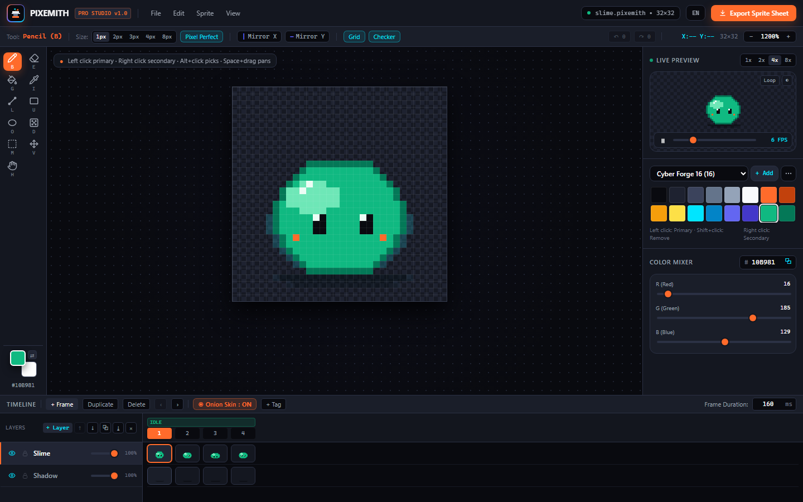
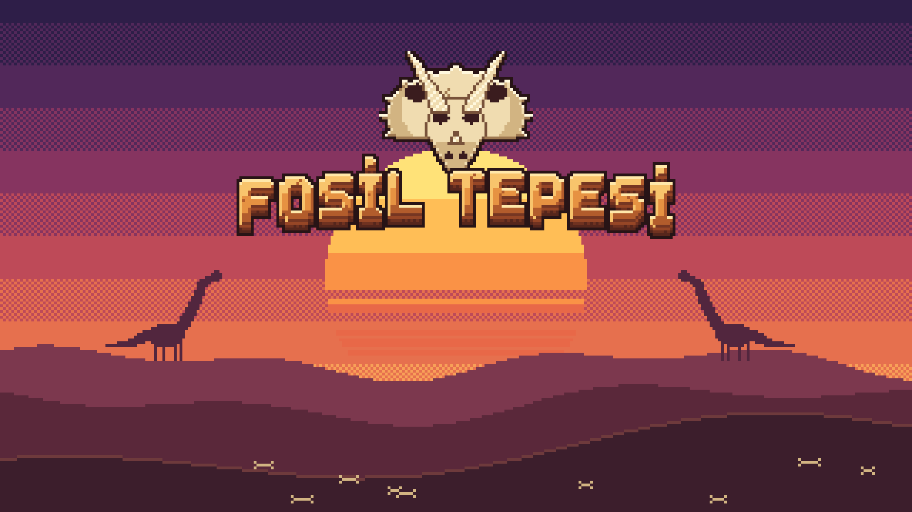

  

  <a href="#-truck-tms"><b>🚚 Truck TMS</b></a> ·
  <a href="#-pixemith"><b>🎨 Pixemith</b></a> ·
  <a href="#-fosil-tepesi"><b>🦖 Fosil Tepesi</b></a> ·
  <a href="#-about-me--hakkımda"><b>👋 About · Hakkımda</b></a> ·
  <a href="#-get-in-touch--bana-ulaşın"><b>💬 Contact · Bana ulaşın</b></a>

  
  
  

 

## 🚚 Truck TMS

<table>
<tr>
<td width="50%" valign="top">

**🇬🇧 A free TMS for small trucking fleets**

Trucks, drivers, loads, weekly statements, invoices, IFTA and compliance reminders in one desktop app.
Your data stays on your own computer: **no account, no subscription, no cloud.**

</td>
<td width="50%" valign="top">

**🇹🇷 Küçük nakliye filoları için ücretsiz TMS**

Tırlar, sürücüler, yükler, haftalık hesap dökümleri, faturalar, IFTA ve evrak hatırlatmaları tek bir masaüstü uygulamasında.
Verileriniz kendi bilgisayarınızda kalır: **hesap yok, abonelik yok, bulut yok.**

</td>
</tr>
</table>

  
  

  
  
  
  
  

### ⚡ Try it in 1 minute · 1 dakikada dene

| | 🇬🇧 English | 🇹🇷 Türkçe |
|:-:|---|---|
| **1** | From the [latest release](https://github.com/ArslanEren-Dev/truck-tms/releases/latest), download **TruckTMS-Setup.exe** (installer) or **TruckTMS.exe** (portable). | [Son sürümden](https://github.com/ArslanEren-Dev/truck-tms/releases/latest) **TruckTMS-Setup.exe**'yi (kurulum) ya da **TruckTMS.exe**'yi (taşınabilir) indirin. |
| **2** | Run it. The installer adds Start menu and desktop shortcuts; the portable exe needs nothing. | Çalıştırın. Kurulum Başlat menüsü ve masaüstü kısayolu ekler; taşınabilir exe hiçbir şey istemez. |
| **3** | If Windows shows a blue SmartScreen box, click **More info → Run anyway**. | Windows mavi bir SmartScreen uyarısı gösterirse **Ek bilgi → Yine de çalıştır**'a tıklayın. |

<table>
<tr>
<td width="50%">
Overview · Genel bakış
</td>
<td width="50%">
Weekly statement · Haftalık döküm
</td>
</tr>
<tr>
<td width="50%">
Load board · Yük panosu
</td>
<td width="50%">
Dark theme in Turkish · Koyu tema, Türkçe
</td>
</tr>
</table>

<b>✨ What's inside · Neler var?</b>

 

| 🇬🇧 | 🇹🇷 |
|---|---|
| 🚛 Trucks with plate history, odometer and owner | 🚛 Plaka geçmişi, kilometre ve sahibiyle tırlar |
| 👤 Drivers with % / per-mile / weekly pay | 👤 Yüzde, mil başı veya haftalık maaşlı sürücüler |
| 📦 Loads with profit per load and rate per mile | 📦 Yük başına kâr ve mil başı ücretle yükler |
| 🗂️ Drag-and-drop load board and a Today list | 🗂️ Sürükle-bırak yük panosu ve Bugün listesi |
| 🧾 Weekly owner & driver statements as PDF | 🧾 Sahip ve sürücü için PDF haftalık dökümler |
| 💵 Invoices, receivables, quick pay / factoring | 💵 Faturalar, alacaklar, hızlı ödeme / factoring |
| 🗺️ IFTA quarterly worksheet | 🗺️ Üç aylık IFTA çalışma sayfası |
| 🛡️ CDL, medical card, insurance and UCR reminders | 🛡️ CDL, sağlık kartı, sigorta ve UCR hatırlatmaları |
| 🔧 Maintenance, expenses, Excel import, charts | 🔧 Bakım, giderler, Excel'den aktarma, grafikler |
| 💿 Windows installer or a portable exe | 💿 Windows kurulum programı ya da taşınabilir exe |

[Changelog · Değişiklikler →](https://github.com/ArslanEren-Dev/truck-tms/blob/main/CHANGELOG.md)

> [!TIP]
> **🇬🇧** Tried it? Tell me what you think in an [issue](https://github.com/ArslanEren-Dev/truck-tms/issues/new/choose). If it helps you, a ⭐ on the repo helps others find it.
>  **🇹🇷** Denediniz mi? Görüşünüzü bir [issue](https://github.com/ArslanEren-Dev/truck-tms/issues/new/choose) ile yazın. İşinize yaradıysa repoya ⭐ vermeniz başkalarının da bulmasını sağlar.

 

## 🎨 Pixemith

<table>
<tr>
<td width="50%" valign="top">

**🇬🇧 A pixel art studio that runs in your browser**

Draw sprites with layers and frames, animate them on a timeline with onion skin and tags,
then export a sprite sheet for **Phaser, Godot, Unity or CSS**. Nothing to install, and it's free.

</td>
<td width="50%" valign="top">

**🇹🇷 Tarayıcıda çalışan bir piksel sanat stüdyosu**

Katman ve karelerle sprite çizin, onion skin ve etiketlerle zaman çizelgesinde canlandırın,
sonra **Phaser, Godot, Unity ya da CSS** için sprite sheet olarak dışa aktarın. Kurulum yok, ücretsiz.

</td>
</tr>
</table>

  
  

  
  
  
  

 

## 🦖 Fosil Tepesi

<table>
<tr>
<td width="50%" valign="top">

**🇬🇧 Coming soon: a cozy dinosaur farm game**

A pixel-art farming and adventure game made in Unity. Grow crops through four seasons,
raise a Triceratops, ride it into the wild, fish in the lakes and craft everything yourself.

</td>
<td width="50%" valign="top">

**🇹🇷 Yakında: dinozorlu bir çiftlik oyunu**

Unity ile yapılan piksel sanat bir çiftlik ve macera oyunu. Dört mevsim boyunca ekin yetiştirin,
bir Triceratops büyütün, ona binip vahşi doğayı keşfedin, balık tutun ve her şeyi kendiniz üretin.

</td>
</tr>
</table>

  
  
  

 

## 👋 About me · Hakkımda

<table>
<tr>
<td width="50%" valign="top">

- 🎓 Software student from **Türkiye**
- 🚚 Building **Truck TMS**, a free TMS for trucking
- 🖌️ Making **Pixemith**, a pixel art studio for the web
- 🎮 Making games with **C#** and **Unity**
- 🎨 Pixel art and **Blender** in my free time
- 💬 You can write to me in English or Turkish

</td>
<td width="50%" valign="top">

- 🎓 **Türkiye**'den bir yazılım öğrencisiyim
- 🚚 Nakliye için ücretsiz bir TMS olan **Truck TMS**'i geliştiriyorum
- 🖌️ Web için bir piksel sanat stüdyosu olan **Pixemith**'i yapıyorum
- 🎮 **C#** ve **Unity** ile oyun yapıyorum
- 🎨 Boş zamanlarımda piksel sanat ve **Blender**
- 💬 Bana Türkçe ya da İngilizce yazabilirsiniz

</td>
</tr>
</table>

  

## 💬 Get in touch · Bana ulaşın

  
  
  

